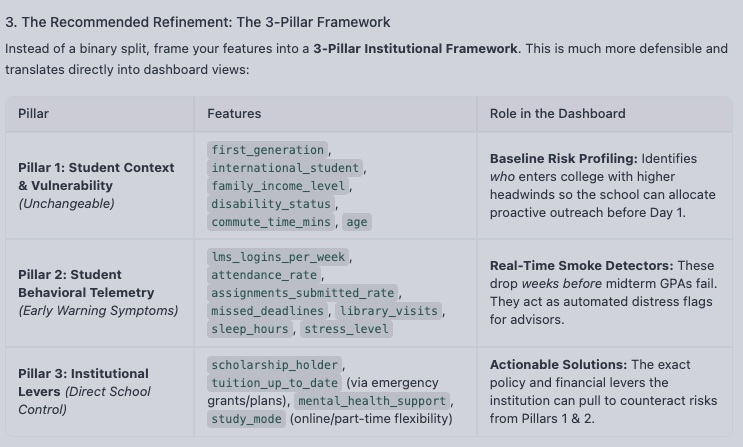

## The Recommended Refinement: 
The 3-Pillar Framework
Instead of a binary split, frame your features into a 3-Pillar Institutional Framework. This is much more defensible and translates directly into dashboard views:

### A. Buffer / Interaction Analysis (How School Support Offsets Risk)

    - Financial Aid Buffer:
         In your dataset, low-income students without a scholarship face a 49.1% dropout rate. When granted a scholarship, dropout drops to 40.3% (an absolute 8.8 percentage point reduction).

    - Workload & Flexibility: 
        Students working >18 hours/week face a 44.6% dropout rate. The actionable insight is offering part-time study modes or asynchronous LMS materials to prevent burnout.

    - Mental Health & Stress: 
        Dropout climbs steadily from 17% at stress_level = 1 up to 44% at stress_level = 10. You can show which student segments with high stress are underutilizing mental_health_support = 0.

### B. Telemetry as an Early Alert System (Predicting Before Grades Drop)

Show feature importances for a model built without gpa_semester_1 / gpa_semester_2 / units_passed.

Features like attendance_rate ($r = -0.28$), assignments_submitted_rate ($r = -0.28$), and missed_deadlines ($r = +0.28$) provide strong predictive power during the first 4–6 weeks of class, allowing advisors to intervene before the semester is lost.
C. Student Archetypes (For the Dashboard's Triage View)
Cluster or segment your students into actionable profiles:

    - "The Overburdened Worker": High work hours, low sleep, missed deadlines, low income $\rightarrow$ Intervention: Emergency stipend, course load reduction, flexible deadlines.

    - "The Disengaged Online/Commuter Student": High commute time, low LMS logins, low library visits $\rightarrow$ Intervention: Peer mentor pairing, campus integration check-ins.
    
    - "The High-Stress Struggler": High stress, first-gen or international, zero mental health support $\rightarrow$ Intervention: Proactive counseling outreach, student group onboarding.